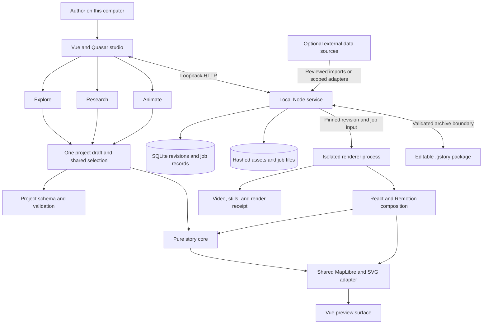
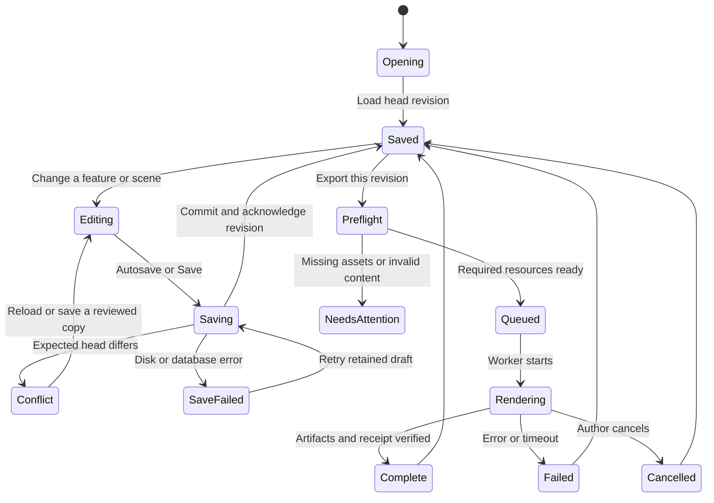

# System architecture

Contributors can use this plan to build a local storytelling application without
coupling the editor, research, and video renderer to one framework. The first
release connects a Vue editor to a local Node service and a separate Remotion
renderer through saved project data and a shared frame evaluator.

**Status: planned, not implemented.** The repository inspection on November 11,
2026 found no application, package manifests, or test commands. File paths,
interfaces, and behaviors in this document are implementation requirements.

- [Architecture decisions](#architecture-decisions)
- [System boundary](#system-boundary)
- [Proposed repository tree](#proposed-repository-tree)
- [Package dependency rules](#package-dependency-rules)
- [Local service interface](#local-service-interface)
- [Persistence and revisions](#persistence-and-revisions)
- [Save and recovery lifecycle](#save-and-recovery-lifecycle)
- [Import and export boundaries](#import-and-export-boundaries)
- [Development and shutdown](#development-and-shutdown)
- [Later desktop packaging](#later-desktop-packaging)
- [Evidence and unresolved gates](#evidence-and-unresolved-gates)

## Architecture decisions

The following decisions keep the four-day build focused on an editable film and
its supporting evidence.

| Concern | Planned decision | Reason |
| --- | --- | --- |
| Authoring | Vue 3, TypeScript, Quasar CLI with Vite | One application shell for Explore, Research, and Animate. |
| Maps | MapLibre GL JS with a shared browser adapter | The editor and export must apply the same resolved frame state. |
| Geographic operations | Selected Turf modules inside a framework-independent core | Geometry operations remain reusable and testable without a UI. |
| Video | React and Remotion inside `apps/renderer` only | Remotion is a rendering dependency, not a second authoring framework. |
| Runtime | Node 24 LTS, initially the inspected `24.22.1`, with npm workspaces | The installed LTS line avoids an unnecessary runtime migration. |
| Storage | SQLite through `node:sqlite`, plus immutable files in a local data directory | Saved projects need transactions; large assets do not belong inside JSON. |
| SQLite driver | `DatabaseSync`, isolated behind a repository module | The installed Node runtime avoids an additional native module installation. |
| Collaboration | One local service, optimistic revision checks, no live collaboration | A second browser tab must not silently overwrite the first. |
| Portable project | Versioned `.gstory` ZIP archive | The shareable file preserves editable content rather than only a video. |
| Remote services | Optional data retrieval with explicit source handling | Local authoring, saving, package import, and rights-cleared fixture export need no account or paid API. |
| Desktop app | Quasar Electron packaging after the film workflow passes | Desktop packaging must not consume the initial four-day build. |

The SQLite driver choice is a deliberate dependency risk: the Node 24 API is
marked release candidate, not stable. The first persistence gate must prove
transaction rollback, reopening, conflict handling, and recovery on the pinned
runtime; any switch to another driver requires a documented compatibility
decision. The database schema and HTTP interface must not depend on driver
specific objects. [Node 24.22.1 SQLite API](https://github.com/nodejs/node/blob/v24.22.1/doc/api/sqlite.md)

The project must not introduce hosted deployment, accounts, cloud rendering,
an AI service, or a mandatory tile API key to pass its initial acceptance gates.
An internet connection can still be necessary to retrieve new research or map
resources; local operation does not imply that every third-party map is offline.

## System boundary

The planned system separates authoring from long-running exports. Both visual
paths consume the same schema, evaluation code, and map adapter.



The **studio** owns interaction and the unsaved draft. The **local service**
owns disk access, durable revisions, import validation, and job scheduling.
The **renderer** reads a frozen revision and writes output artifacts; it must
not save edits or query live research while evaluating a frame.

The **story core** evaluates timing, camera values, geographic traces,
visibility, and roadway geometry without Vue, React, MapLibre, a browser, or a
database. The **map adapter** applies the result to MapLibre and a generated SVG
overlay; SVG is the vector drawing format used for labels and leader lines.
The [rendering contract](rendering-contract.md) defines their exact responsibilities.

## Proposed repository tree

This tree names the intended source locations. It is a build plan, not an
inventory of files that already exist; contributors should create each part
when its sprint task begins.

```text
storytelling-studio/
  package.json
  package-lock.json
  tsconfig.base.json
  .node-version
  .env.example
  .gitignore
  apps/
    studio/
      package.json
      quasar.config.ts
      src/
        App.vue
        layouts/StudioLayout.vue
        pages/ExplorePage.vue
        pages/ResearchPage.vue
        pages/AnimatePage.vue
        components/MapSurface.vue
        components/FeatureLibrary.vue
        components/SceneInspector.vue
        components/TimelineStrip.vue
        components/ResearchCard.vue
        components/RoadwayEditor.vue
        components/ExportDialog.vue
        stores/project-store.ts
        stores/selection-store.ts
        services/local-api.ts
        services/preview-controller.ts
        router/routes.ts
        css/app.scss
    local-service/
      package.json
      src/
        server.ts
        config.ts
        db/database.ts
        db/project-repository.ts
        db/migrations/001-initial.sql
        routes/projects.ts
        routes/assets.ts
        routes/imports.ts
        routes/jobs.ts
        routes/research.ts
        services/asset-store.ts
        services/resource-resolver.ts
        services/job-runner.ts
        packaging/import-gstory.ts
        packaging/export-gstory.ts
        research/source-adapters.ts
    renderer/
      package.json
      src/
        index.tsx
        StoryComposition.tsx
        MapFrameHost.tsx
        render-job.ts
        render-receipt.ts
  packages/
    project-schema/
      package.json
      src/project.ts
      src/api.ts
      src/validation.ts
      src/migrations.ts
    story-core/
      package.json
      src/evaluate-frame.ts
      src/timeline.ts
      src/camera.ts
      src/geometry.ts
      src/layers.ts
      src/labels.ts
      src/roadway.ts
    map-adapter/
      package.json
      src/mount.ts
      src/apply-frame.ts
      src/readiness.ts
      src/svg-overlay.ts
      src/resources.ts
  scripts/
    dev.mjs
    dev-status.mjs
    dev-stop.mjs
    check.mjs
    render-fixture.mjs
  tests/
    core/
    persistence/
    render-contract/
    package/
    research/
    roadway/
    smoke/
    fixtures/synthetic-story/
  docs/
    architecture/
    contributor-guides/
    design/
    planning/
    test-procedures/
  .local/
    storytelling-studio/
      studio.sqlite
      assets/sha256/
      jobs/
      imports/
      backups/
      runtime/
  out/
    verification/
```

The future `.gitignore` must exclude `.local/`, `out/`, dependencies, build
outputs, and local configuration containing private data. The data directory
must be configurable through `STORY_STUDIO_DATA_DIR`; the development default
is `.local/storytelling-studio` inside the checkout. A project archive must
never contain a developer's absolute data-directory path.

## Package dependency rules

The package names and import directions are fixed by the following contract.
An arrow means that the package on the left can import the package on the right.

```text
@gstory/project-schema -> validation library and type-only GeoJSON definitions
@gstory/story-core     -> @gstory/project-schema, selected Turf modules
@gstory/map-adapter    -> @gstory/project-schema, @gstory/story-core, maplibre-gl
@gstory/studio         -> the three shared packages, Vue, Quasar, Pinia, Vue Router
@gstory/renderer       -> the three shared packages, React, Remotion packages
@gstory/local-service  -> @gstory/project-schema, @gstory/story-core,
                         Node built-ins, ZIP library
```

The local service starts the renderer through a process contract, rather than
importing its React composition. The root workspace coordinates builds; a
renderer job receives a validated input JSON file and an output directory
chosen by the local service. A job must not accept arbitrary executable paths,
shell fragments, or commands from a project file.

Contributors should enforce the following boundaries in dependency checks.

- The studio and shared packages must not import React or Remotion.
- The story core and schema must not import UI frameworks, MapLibre, Node file
  APIs, clocks, or network clients.
- The map adapter must not import Vue or React; both host components delegate
  mounting, drawing, and readiness to the same adapter.
- The renderer must not import the studio's stores, router, or components.
- Research adapters must return validated snapshots through the service;
  animations must not call a research adapter.

The schema package should expose runtime validation and TypeScript types from
one definition. A small schema library is acceptable; selecting and pinning it
belongs to the initial dependency check, not an implicit architecture change.
The initial implementation must not create a plugin system, command language,
dependency injection framework, or generic event bus.

## Local service interface

The local service must bind to `127.0.0.1` and verify the request host. The studio
must use a same-origin API in a built application; during development, the
Quasar server must proxy the API to the loopback service. The launcher must
record actual ports and process ownership so that startup and shutdown target
this checkout only.

The service must accept mutations only from its allowed local origin with a
per-run request token supplied by the launcher. This token protects the local
HTTP interface from unrelated web pages; it does not create a user account,
sign-in flow, or hosted authentication requirement. The service must not expose
a general file browser, arbitrary path reader, or unrestricted URL proxy.

The following planned endpoints define the first service boundary. JSON bodies
and responses must be validated by `@gstory/project-schema`; file uploads use
multipart bodies and their own size limits.

| Endpoint | Accepted input | Result and important failure |
| --- | --- | --- |
| `GET /api/health` | No body | Runtime, schema, and database readiness; `503` if not ready. |
| `GET /api/projects` | No body | Local project summaries, sorted by update time and ID; no remote results. |
| `POST /api/projects` | `title`, `clientMutationId` | New project and initial revision; `201`. |
| `GET /api/projects/:projectId` | Opaque project ID | Head revision envelope and complete document; `404` if absent. |
| `GET /api/projects/:projectId/revisions/:revisionId` | Matching project and revision IDs | Immutable saved document; `404` for a mismatched pair. |
| `PUT /api/projects/:projectId` | `expectedRevisionId`, `clientMutationId`, `document` | New revision envelope; `409` if the head changed. |
| `POST /api/assets` | File plus provenance and rights fields | Hash, media details, and asset descriptor; `413` or `422` for rejected input. |
| `GET /api/assets/:sha256` | A validated lowercase content hash | Read-only stored bytes for the authoring preview; `404` for an unknown hash, never an arbitrary file path. |
| `POST /api/imports` | File plus `kind`: `gstory`, `geojson`, or `image` | Validated staging report and import ID; no project mutation. |
| `POST /api/imports/:importId/commit` | Reviewed import decisions; target project and expected revision only when adding features | Atomic new project or target revision; `409` if the target changed. |
| `POST /api/projects/:projectId/render-jobs` | Saved `revisionId`, output variant IDs, `profile` | Job ID and `202`; `422` for unresolved required assets or invalid scenes. |
| `POST /api/projects/:projectId/package-jobs` | Saved `revisionId`, package mode | Job ID and `202`; rights inspection precedes archive assembly. |
| `GET /api/jobs/:jobId` | Job ID | State, progress, diagnostic code, and downloadable artifact IDs. |
| `GET /api/jobs/:jobId/resources/:resourceId` | Job ID and opaque input resource ID | Read-only immutable input bytes with verified media type; `404` for any resource outside the job's pinned manifest. |
| `POST /api/jobs/:jobId/cancel` | Job ID | Cancellation request; repeated requests have the same effect. |
| `GET /api/jobs/:jobId/artifacts/:artifactId` | Server-issued IDs | Finished file stream; no user-supplied filesystem path. |
| `POST /api/research/jobs` | Pinned feature revision, named source adapter, method and parameters | Day 3 scoped research job; never an arbitrary URL fetch instruction. |

The initial local project list can return all project summaries. A configurable
default limit of 1,000 local projects is a proposed implementation guardrail,
not a product requirement; reaching the configured limit must show a capacity
error rather than silently truncate results. Pagination can follow
demonstrated need rather than becoming a first-day prerequisite.

The service must return errors as `{code, message, details, retryable}`. The
`details` object must contain safe field paths or missing resource IDs, not
stack traces, access tokens, or absolute personal paths. Invalid documents use
`422`; missing resources use `404`; oversized uploads use `413`; a full disk or
database write failure must leave the preceding revision readable.

The renderer must load project assets through the job resource endpoint, never
through `file://` URLs or user-provided absolute paths. The service must map an
opaque resource ID to a verified hash in that job's frozen input manifest and
serve it read-only; it must not accept a path or forward a request to a remote
URL. The local renderer page must be served from the trusted local origin or
an explicitly registered local rendering origin, with the narrow resource
access configured by the job runner.

The map adapter must resolve each style, GeoJSON, tile, font, image, sprite, or
glyph reference through this manifest. A dynamic tile URL can resolve only when
its exact expanded resource key exists in the pinned set; an unlisted request
must fail rather than become an unrestricted proxy. The first local GeoJSON
basemap does not require a general tile caching service.

The service must retain successful mutation IDs and their request hashes for a
documented period, initially seven days as a configurable default. Repeating
the same ID and body must return its original revision;
reusing an ID with a different body must return `409`. A retry after this window
must still satisfy `expectedRevisionId`, so an old write cannot overwrite a
newer revision unnoticed.

## Persistence and revisions

A *revision* is an immutable copy of a complete project document at a successful
save. The first build should store the document as validated JSON rather than
normalize every scene, label, and research field into separate SQL tables.
That choice keeps project portability and revision recovery aligned.

The planned database contains the following records.

| Table | Key fields | Purpose |
| --- | --- | --- |
| `schema_migrations` | `version`, `applied_at` | Records local database migrations separately from project format migrations. |
| `projects` | `id`, `title`, `head_revision_id`, `updated_at` | Stores the current saved head and library metadata. |
| `project_revisions` | `id`, `project_id`, `ordinal`, `parent_id`, `schema_version`, `document_json`, `document_sha256`, `created_at` | Preserves complete, immutable project documents. |
| `assets` | `sha256`, `media_type`, `byte_length`, `relative_path`, `created_at` | Indexes content-addressed files in the local asset store. |
| `revision_assets` | `revision_id`, `asset_sha256` | Prevents removal of assets used by retained revisions or jobs. |
| `jobs` | `id`, `project_id`, `revision_id`, `kind`, `state`, `input_json`, `progress_json`, `error_json`, `artifact_manifest_json` | Tracks package, research, and rendering work. |
| `mutations` | `project_id`, `client_mutation_id`, `request_sha256`, `result_revision_id`, `created_at` | Makes save retries safe. |

The service must enable foreign keys and use prepared statements. The local
service must own the database connection and serialize short write
transactions; renderer children must receive snapshots rather than database
connections. The service must select WAL mode, `synchronous=FULL`, and a bounded
busy timeout, then record the effective settings in diagnostic output.

SQLite WAL mode allows readers and a writer to proceed concurrently, but it
still has one writer at a time and requires storage on the same host. The app's
live database directory must not be placed on a network filesystem or treated
as a multiuser synchronization folder. [SQLite WAL documentation](https://sqlite.org/wal.html)

A save transaction must validate the document, verify the expected head,
insert the immutable revision and asset references, advance the project head,
and record the mutation result together. The new head must become visible only
after commit. The UI must display **Saved** only after it receives that committed
revision ID; an in-memory edit or an upload completion is not a saved project.

The service must write imported asset bytes to a temporary file, verify their
hash and type, then move them into the content-addressed store before committing
a revision that references them. A crash can leave an unreferenced file, which
is safer than a committed reference to missing bytes. The initial build must
retain unreferenced assets; garbage collection is deferred until retention and
backup behavior have been tested.

The editor must debounce autosave after an edit settles and allow an explicit
**Save** action; 750 milliseconds is an initial configurable default. A pending
save must serialize behind the
previous save and use the revision ID returned by that save. Undo and redo
change the draft; saving an undo creates a new revision rather than deleting
history.

## Save and recovery lifecycle

The planned lifecycle distinguishes an unsaved draft, a durable revision, and
an export pinned to that revision.



The studio must preserve the unsaved draft after a save failure or `409`
conflict. The conflict screen must offer **Reload saved version** and **Save as
copy**, show which version is newer, and require an explicit choice before
discarding the draft. Automatic merging is outside the first build.

The service must mark jobs left in `running` state after an unclean shutdown as
`interrupted`, retain their diagnostics, and offer a clean retry from the same
revision. An interrupted MP4 file must not appear as a completed artifact.
Restarting a job must not change its source revision or silently replace a
missing asset with newly downloaded bytes.

The startup check must open SQLite normally, run a bounded integrity check, and
verify that the current head references exist. A failed check must stop writes
and present recovery from the last backup or an imported package; it must not
reset the database automatically. The service must never delete WAL files as a
repair shortcut.

The service must create a consistent database backup before database migrations
and offer a manual backup action after the core workflow exists. A backup must
use SQLite's backup facility or a documented closed-database procedure, not a
copy of an open main database file that omits its WAL. Portable `.gstory`
exports preserve selected project content, while database backups preserve the
local revision library; neither should be described as the other.

## Import and export boundaries

The archive importer must validate content in a staging directory before any
project becomes visible. The [project format](project-format.md) is the
canonical contract for archive paths, schema migration, hashes, rights,
resource limits, and missing assets. A successful import must create a new
local project identity and retain the source identity as provenance.

The service must pin every export to an immutable revision and its exact asset
bytes. Rendering must never read the moving draft or the current head through
an unversioned URL. A package or video export must include a receipt that
identifies the revision, required resources, output variant, and result.

The data adapter boundary must allow named, narrow retrieval operations such
as a published statistics table or a verified geometry file. It must record
source URL, retrieval date, data vintage, license or usage terms, and method
parameters in the resulting snapshot. The service must validate redirects,
reject private-network destinations for external source retrieval, limit
response size and time, and exclude credentials from portable content.

The initial exporter must support a completely local synthetic fixture and
projects whose required resources are already present. Live map exploration
can use an approved public provider, but a render must resolve its required
resources under that provider's terms before the render begins. Tile-library
licenses and tile-provider terms are separate decisions.

## Development and shutdown

No startup commands exist as of the inspection date. The canonical
[command and gate plan](../planning/testing-and-gates.md) specifies the future
`npm run dev`, `npm run dev:status`, and `npm run dev:stop` contracts, plus the
focused validation commands. Contributors must not document those commands as
working until their scripts and verification evidence exist.

The future one-time setup must pin Node, npm, package versions, renderer browser
dependencies, and the lockfile. The session launcher must start the service and
Quasar development server, wait for database and HTTP readiness, then print the
studio URL. It must not report success because processes merely started.

The shutdown path must stop this checkout's child jobs and servers, flush
completed saves, close the database, and release ports. The launcher must
handle `Ctrl+C` using the same shutdown path as `dev:stop`. Saved revisions and
assets remain in the configured data directory; an unsaved browser draft is
not guaranteed to survive a closed tab.

The proposed [persistent development controller](../planning/agent-controller.md)
is a separate tool with its own execution database and process lifetime. The
application must not import it, launch it through `npm run dev`, store its state
in a `.gstory` package, or require GitHub or an AI account for ordinary use.
Each parallel worktree needs its own application data, ports, caches, and
process records; Git worktrees isolate working files, not those runtime resources.

## Later desktop packaging

The later desktop application should use Quasar's Electron mode around the
existing studio and local-service boundary. The desktop main process can own
the data directory, file dialogs, and service lifetime; a narrow preload bridge
can expose those native capabilities. The renderer process must retain context
isolation and must not gain direct Node filesystem access. [Quasar Electron architecture](https://quasar.dev/quasar-cli-vite/developing-electron-apps/introduction/)

The desktop phase requires installer, signing, updater, bundled browser,
database migration, media codec, and third-party redistribution decisions.
Those decisions do not belong in the four-day film acceptance path. Stable
project data and service contracts are the preparation for that work.

## Evidence and unresolved gates

The following evidence supports the selected direction without claiming that
the proposed integration has already passed.

| Evidence checked on November 11, 2026 | Consequence for this plan |
| --- | --- |
| [Quasar CLI documentation](https://quasar.dev/start/quasar-cli/) names `@quasar/app-vite` and supports npm. | Use Quasar CLI with Vite and an npm workspace; pin compatible versions in the first gate. |
| [Node release information](https://nodejs.org/en/about/previous-releases) lists Node 24 and 26 as LTS. | Node 24 is a supported conservative starting line, rather than a claim that it is the newest release. |
| [Remotion map documentation](https://www.remotion.dev/docs/maps) covers MapLibre and Turf integration. | The bridge is plausible, but the first-day readiness and repeated-seek tests remain mandatory. |
| [Remotion's source license](https://github.com/remotion-dev/remotion/blob/main/LICENSE.md) includes nonprofit and not-for-profit eligibility for its free license. | The owner's November 11, 2026 confirmation of Dallas Urbanists' nonprofit/not-for-profit operation supports eligibility for this use. |

Remotion is not an MIT-licensed dependency. Its current source license also
distinguishes eligible individuals and small for-profit organizations from
organizations requiring a company license; collaborators and downstream
distributors must evaluate their own use. The implementation must retain the
exact installed license text, verify version-specific conditions, and avoid
assuming that future Electron distribution has already been cleared.

The [Remotion terms landing page](https://www.remotion.dev/docs/terms) identifies
its version 5 terms as upcoming as of the evidence check; the
[version 4 terms](https://www.remotion.dev/docs/terms-4-0) are a separate document.
Contributors must check the terms associated with the pinned package version
rather than use the landing page's version number as a release signal.

The open engineering gates are deterministic map readiness on the target
Windows machine, compatible local rendering binaries, SQLite recovery on the
pinned runtime, and source-specific asset permissions. The first gate must
resolve the rendering bridge before a large editor interface is built.
