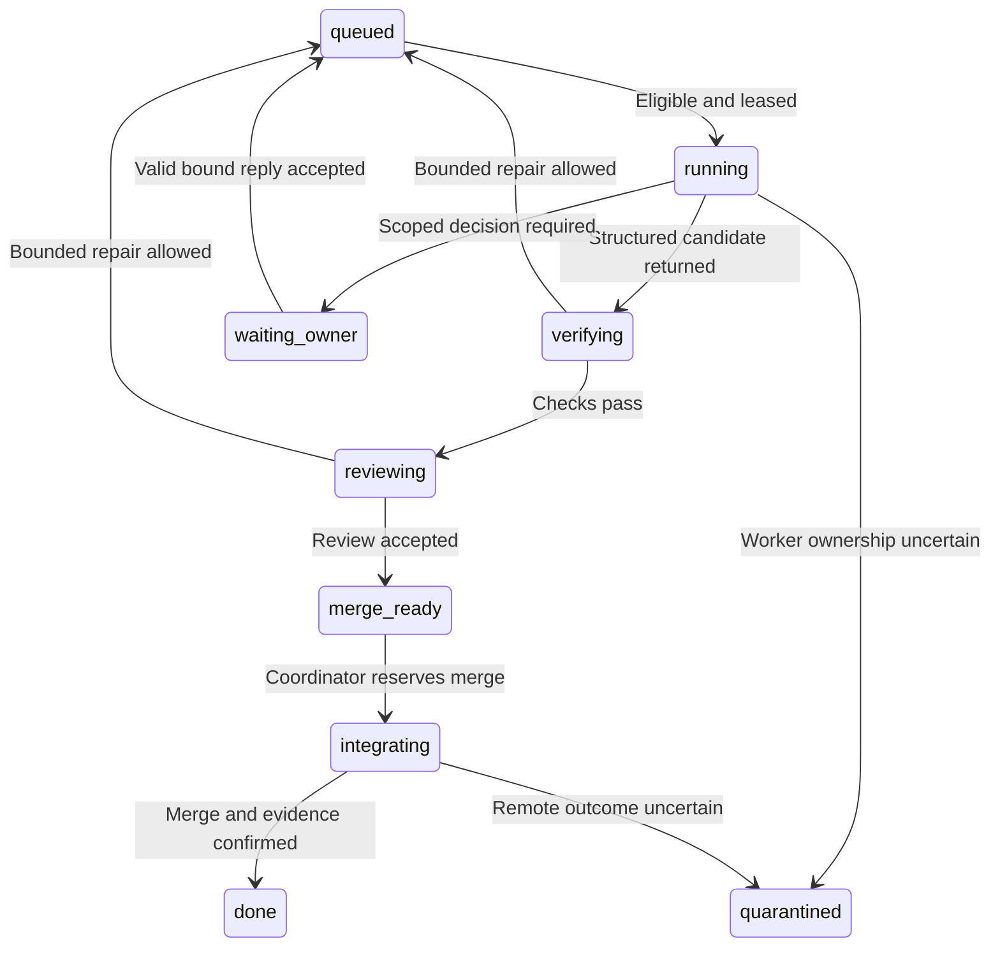

# Persistent agent controller

The implementation lead can use this plan to run independent issues through
Terra and Sol workers while keeping decisions, retries, and merges accountable.
Routine scheduling belongs to a deterministic local supervisor; model calls
belong to bounded implementation and review work.

**Status: planned, not running.** No controller or worker adapter has been
implemented or verified. This design does not authorize a new orchestration
build, installation, background task, GitHub mutation, or application work;
[orchestration activation](orchestration-activation.md) evaluates readiness
separately from the application MVP and its implementation kickoff.

- [Runtime and authority](#runtime-and-authority)
- [Deterministic scheduling](#deterministic-scheduling)
- [Issue states and ownership](#issue-states-and-ownership)
- [Worker adapter and worktrees](#worker-adapter-and-worktrees)
- [Durable state and restart](#durable-state-and-restart)
- [One integration coordinator](#one-integration-coordinator)
- [Questions answered from a phone](#questions-answered-from-a-phone)
- [Reply validation and approval scope](#reply-validation-and-approval-scope)
- [Polling and idempotent delivery](#polling-and-idempotent-delivery)
- [Retry and resource budgets](#retry-and-resource-budgets)
- [Orchestration readiness checklist](#orchestration-readiness-checklist)
- [Stop and recovery](#stop-and-recovery)
- [Verified interface evidence](#verified-interface-evidence)

## Runtime and authority

The smallest proposed runtime is one Windows Node supervisor, one local SQLite
journal, a GitHub REST client, and a tested Codex CLI subprocess adapter. It
allows two worker processes total, including review workers, and one integration
coordinator inside the supervisor. A cloud server, public listener, webhook
endpoint, or recurring model call is unnecessary.

The supervisor must run independently of this chat. An optional, explicitly
configured Windows logon task can restart it in a hidden process; this chat
does not create a daemon or remain a persistent scheduler after it ends.
The computer must remain awake and connected for new model work and phone
replies; sleep, shutdown, or lost connectivity delays automatic resumption.

The proposed implementation home is `tools/agent-controller/`, outside the
application workspaces. Its ignored state belongs in
`.local/agent-controller/` in the controller checkout, outside worker worktrees.
The controller must own its SQLite file, logs, receipts, staged results, and
configured worktree root; none belongs in a `.gstory` project or app database.

The controller must act only within recorded publication, implementation, and
orchestration activation authority. Ordinary approved issue execution must not
ask for repeated permission; secrets, permissions, licensing, and substantial
scope changes retain the boundaries in [AGENTS.md](../../AGENTS.md).
Repository comments record owner authorization; they cannot satisfy an
interactive host prompt, override automatic approval review, or grant filesystem
and tool privileges. The adapter must stop affected work with an actionable
diagnostic when host approval or local sign-in is still required, without using
dangerous bypass flags; full phone operation remains unproven until resolved.

## Deterministic scheduling

The [execution schedule](execution-schedule.md) is the canonical queue metadata.
The controller must pin its commit and validated contents, reject unknown IDs,
dependency cycles, missing fields, and unsupported conditions, and compare it
with issue contracts. The sole external prerequisite `P03` must resolve through
a verified publication-audit receipt and commit at activation, not a fabricated
GitHub issue; all other dependencies must resolve to schedule rows.

| Schedule field | Controller interpretation |
| --- | --- |
| `ID` | Stable product-issue identity mapped to a verified GitHub issue number; external prerequisite `P03` has its separate receipt. |
| `requiresAll`, `requiresAny` | All prerequisites and any required alternative must have accepted merged evidence, or the defined external receipt for `P03`; `-` means no constraint. |
| `stream` | Reporting grouping, never an implicit dependency or authorization. |
| `model`, `reasoning` | Exact per-issue assignment from the model-routing policy. |
| `priority` | Lower number first, then stable issue ID for a repeatable tie-break. |
| `leases` | Exclusive shared-file conflict groups, supplemented by exact issue-owned paths. |
| `condition` | An approved activation-profile predicate, never natural-language interpretation. |

The supported conditions are `baseline`, `history`, `income`, `imagery`, and
`imagery-cleared`. Optional flags default off; `imagery-cleared` additionally
requires the accepted source/rights receipt identified by the schedule.
Disabled work remains `deferred`, not falsely completed, and cannot satisfy a
required dependency without an approved revised dependency contract.

An issue is eligible only when authority, dependencies, condition, model
availability, decision state, file reservations, and resource capacity all
permit it. The controller must atomically reserve the first eligible issue,
then repeat until two slots are occupied or no eligible work remains.
Date labels do not require idle time between otherwise eligible milestones.

The scheduler must use ordinary code for queue selection, polling, timers,
grammar parsing, and state transitions. Those activities consume no model
tokens; implementation, review, and a substantive repair still do. The
[model-routing policy](../policies/model-routing-policy.md) governs Terra/Sol
assignments; scheduling must never select Astra for implementation.

## Issue states and ownership

The planned lifecycle makes a blocked issue local to its affected dependencies.



The controller must distinguish an exclusive conflict-group reservation from a
worker liveness lease. A reservation remains with the issue through review,
merge, or a parked decision; the parked issue releases its worker slot and
render capacity so unrelated issues continue. New files require an atomic
reservation extension before editing; a path conflict pauses only affected work.

Each worker attempt must carry a unique attempt ID, controller epoch, and
monotonically increasing fencing token. A lease heartbeat initially runs every
15 seconds with a 90-second expiry; these are configurable defaults. The
controller must reject results and side-effect requests bearing a stale token.

A missed heartbeat is evidence of uncertainty, not proof that a process stopped.
The controller must quarantine that attempt, verify PID plus process creation
time, and stop or establish the absence of its process tree before reallocating
its files or starting a replacement. Fencing rejects stale results but cannot
stop a surviving process from writing its existing worktree.

The GitHub issue must remain open while waiting for its owner, with
controller-owned `blocked` and `needs-owner-decision` labels and a question URL
in the status receipt. A valid answer must clear only that decision's blocker,
remove controller-applied labels only when no corresponding blockers remain,
recompute eligibility, and post one queued/resumed acknowledgment; it must not
erase human-applied labels or pause unrelated issues.

## Worker adapter and worktrees

The proposed adapter uses the installed Codex CLI's non-interactive interface.
It must set the exact model, reasoning configuration, working directory,
sandbox, JSON event output, and final result schema through supported options,
with an argument array and input file rather than shell-built command text.
No complete launch command is supplied until its installed version is tested.

A worker input must include issue and contract hashes, base commit, reserved
paths, acceptance checks, approved decisions, budget, and stop conditions.
Its final schema must contain `attemptId`, `fencingToken`, `outcome`, changed
paths, check commands/results, evidence paths, remaining work, and any structured
question. `outcome` must be `candidate`, `needs_decision`, `blocked`, or `failed`;
review receipts must separately use `accepted` or `changes_requested`, with
findings, rather than replace actual check evidence with a completion claim.

The adapter must retain the actual CLI thread ID and raw event log locally.
Fresh issue sessions with a durable handoff are the default; resumption can
use only that attempt's explicit session ID after compatibility is verified.
The adapter must never use a global `--last` selector across parallel workers.

The coordinator must create one branch and Git worktree per attempt from a
known merged base, serialize Git administrative mutations, and assign separate
ports, app data, temporary output, and test resources. Shared manifests and
contract files require the schedule's exclusive groups even though files live
in different worktrees. Workers edit and test; the coordinator owns commits,
pushes, pull requests, shared-ledger updates, and merges.

Git worktrees share repository administration and are not security sandboxes.
The adapter must enforce the reviewed sandbox and network policy, avoid passing
GitHub mutation credentials into workers, and run only trusted maintainer-scoped
tasks, not untrusted forks or arbitrary comment instructions. Same-user Windows
credential isolation must be tested, not inferred from separate directories.

The coordinator must validate resolved worktree paths and reject junction or
path escapes before removal or movement. It must retain dirty, failed, or
unmerged worktrees with their receipts; Git worktree locking protects against
cleanup but does not replace the controller's ownership reservations.

## Durable state and restart

The journal must commit state changes and their intended external actions in
one transaction. SQLite durability, integrity checks, and backups must be
verified for the selected driver; the controller must not reuse the app's
mutable project database or treat a JSON log alone as transactional state.

| Durable record | Minimum contents |
| --- | --- |
| Activation and plan | Repository numeric ID, approved scope/mode, `dispatchReady`, `unattendedMergeReady`, schedule hash, owner-ID mapping, model map, and resource/retry limits. |
| Issues and attempts | State/version, base/head commits, branch/path, model, PID/start time, explicit CLI session, epoch/fence, heartbeat, and consumed budget. |
| Reservations | Conflict group or exact path, owning issue/attempt, lease identity, and release reason. |
| Decisions | Question/revision/nonce, kind, scope and artifact hashes, options, expiry, owner allowlist, reply identity/hash, and consumption state. |
| Inbox and outbox | GitHub comment versions, polling cursors/ETags, action ID, expected remote state, delivery attempts, and confirmed remote IDs. |
| Evidence and events | Check/review receipts, artifact hashes, state transitions, errors, and redacted audit history. |

The supervisor must hold a tested process-lifetime singleton, such as an
exclusive loopback socket, before acquiring a new durable controller epoch.
A second instance must refuse dispatch; it must not steal ownership merely
because a timestamp expired. Task Scheduler's no-overlap setting is an
additional safeguard, not the sole singleton proof.

After restart, the controller must reconcile processes, worktrees, branches,
open questions, outbox entries, pull-request heads, checks, and merged state
before dispatching. It must adopt only a provably live owned attempt; otherwise
it quarantines the attempt, preserves its work, and repairs ownership first.
An unanswered question must survive restart without a duplicate post.

## One integration coordinator

The coordinator must independently verify changed paths, relevant checks,
review requirements, and accepted decision scope before creating a candidate.
Workers must supply per-issue documentation deltas; the coordinator applies
shared status, index, backlog, and production-ledger updates in the same pull
request, without making every worker contend for those files.

Only one candidate can integrate at a time. The coordinator must refresh it
against the current base, rerun affected checks, record a real Terra/Sol or
human review as required, and merge only the exact reviewed head. New commits
invalidate matching check/review evidence where the governing rules require it.

Unattended integration must prove server-enforced required checks and an
up-to-date-base rule or a supported configured merge queue. If that proof is
absent, merges wait while unrelated implementation continues; the controller
must not silently change branch protection, bypass checks, force-push `main`,
or treat an empty required-check list as evidence of passing validation.

The initial merge adapter can use the classic endpoint only for direct,
non-stacked pull requests without a merge queue; a configured queue needs a
verified supported adapter. An expected head SHA does not protect the base,
and an asynchronous accepted/enqueued result is not a merge: only confirmed
merged state releases dependencies. Changed bases and uncertain results require
reconciliation, not blind retries or an implicitly enabled queue.

The recommended empty-repository route is explicit `supervised-bootstrap` mode:
verified workers can dispatch, but a supervising coordinator performs initial
integrations through D1-20, where target-repository CI is introduced. The
coordinator verifies ordinary passing merges under existing implementation
authority; it does not request owner approval for every pull request.

Readiness must record `dispatchReady` and `unattendedMergeReady` separately.
The latter requires actual target CI and owner-authorized protection evidence,
not only a successful test repository; separately approved early guard setup is
an alternative. Full unattended operation requires both flags, and bootstrap
must not weaken checks or silently expand the application backlog.

## Questions answered from a phone

The controller must post a bounded question on the affected GitHub issue only
when the issue cannot proceed within existing authority. It must include the
reason, concrete options and impacts, affected scope, linked evidence, expiry,
and copyable reply lines; the author can answer through GitHub Mobile or a
browser. No email or unrelated messaging integration is required.

The initial question should mention the configured decision maker's verified
current GitHub login once and link the blocked issue. Activation must test that
the owner can find and answer the question on their phone; notification delivery
depends on the owner's GitHub settings and is not guaranteed by posting alone.

The following is an illustrative comment template, not a posted question.
Values in braces must be filled from a durable decision record before sending.

```text
Decision Q-0042 r2 / nonce K7F9M2
Issue: {issue ID}; question kind: preference
Blocked action: {one concrete action}; unaffected work continues.
Scope: {scope summary}; artifact/head: {bound immutable identifier}
Evidence: {reviewable links}; expires: {UTC date and time}
A: {recommended bounded option and consequence}
B: {other bounded option and consequence}
C: Defer this issue; keep unrelated work running.
Reply exactly: DECIDE Q-0042 r2 K7F9M2 CHOOSE A
For B or C, replace only the final option letter.
Do not include secrets or private source material in this public issue.
```

Security, permission, licensing, or substantial scope questions must instead
show the exact action and require `APPROVE` or `DENY`, never infer approval from
`CHOOSE`. For an illustrative question `Q-0043 r1`, its documented B action can
have the copyable reply `DECIDE Q-0043 r1 M2Q8R4 APPROVE B` and corresponding
`DECIDE Q-0043 r1 M2Q8R4 DENY B`; these examples authorize nothing themselves.
The grammar is `DECIDE <id> <revision> <nonce> <verb> <option>`, with permitted
verbs and options stored in the question rather than inferred from prose.

## Reply validation and approval scope

Activation must map the actual owner's confirmed GitHub login to its numeric
user ID and the repository's numeric ID through authenticated reads. The owner
must confirm this allowlist; the controller must not guess it from an
organization name, account display name, `author_association`, or write access.
Trust changes require a separate authorized local configuration update.

The parser must accept only a new, exact standalone command from an allowlisted
human user on that question's issue, matching its ID, revision, nonce, allowed
verb/option, pending state, and expiry. It must verify the relevant issue
contract, action, artifacts, commit where bound, and policy hashes before
accepting the answer and queuing only the affected work.

The acceptance transaction must record comment ID, author ID, timestamps, body
hash, decision revision, and authorized action digest, then queue the scoped
resume without consuming a gated authorization. A preference answer cannot
authorize credentials, source-rights assumptions, a new architecture, or a
different commit's gated operation.
Changed bound inputs must supersede the question with a new revision.

Bare “yes,” reactions, quoted commands, bot comments, malformed replies,
expired answers, and untrusted authors cannot resume work. The controller must
explain a trusted author's rejected syntax once per comment version, without
calling a model to guess intent; free-text clarification creates a new reviewed
question rather than becoming executable instructions.

The first valid pending reply wins atomically; duplicates do nothing, and later
conflicting replies require a new decision. Before a gated action, the
controller must refetch the reply and revalidate hashes/scope, then atomically
consume its authorization when creating that exact side-effect intent.
Retries reconcile the same intent without expanding scope or asking again.

Deletion or an edit invalidates an unconsumed authorization; after consumption,
changes become audit events requiring review, not permission to reverse a
completed action. Comments are data, never shell commands or replacement
instructions for a worker's authorized task.

## Polling and idempotent delivery

The REST client must poll pending questions initially every 60 seconds, use
authenticated conditional requests, serialize requests, and honor provider
poll intervals, `Retry-After`, and rate-limit reset headers. It must follow all
pagination links and use an overlapping updated-time window with deduplication
by comment ID, `updated_at`, and body hash; only a fully committed scan advances
the cursor. An ETag belongs to its exact endpoint, query, page, API version, and
media type; a `304` retains that page's cached pagination and says nothing about
other pages. A `404` alone does not establish whether a resource or access is absent.

Every comment, pull request, merge request, or issue-close intent must have a
durable outbox action ID and expected scope/head. Comments must carry a stable
controller marker; an uncertain POST outcome requires searching for that marker
and matching body before retrying. GitHub has no assumed universal idempotency
key: uncertain remote writes must reconcile, and duplicate matching posts must
be identified without repeating the decision's effect.

The controller must post only a new question, material state change, failure,
or completed result, not every poll. It must obtain GitHub credentials through
the reviewed local credential mechanism, redact logs, and use only required
repository permissions; it must never put tokens in comments, prompts, command
arguments, committed files, or copied Codex authentication files.

## Retry and resource budgets

Initial defaults allow one initial run plus at most two substantive repair/recovery
retries per issue and 60 cumulative active worker minutes before a bounded
handoff or split. A restart, owner reply, or model change must not reset the
budget; waiting for a person or rate limit consumes no worker/model call.
A documented Terra-to-Sol escalation follows policy and counts as an attempt.

A fresh session continuing after a valid answer uses the remaining issue budget
and a new execution token; it does not itself consume a repair retry. All model
usage and active time still accumulate, including review and resumed work.

Transient transport retries must be bounded, initially three retries after
5, 15, and 60 seconds; repeated secondary rate limits use 60, 120, and 240
seconds instead, with larger provider delays taking precedence. Repeated failure pauses only
remote-dependent work; permitted independent local work can continue, and
health probes use capped backoff. Exhausted technical retries apply `blocked`
without `needs-owner-decision` unless owner input is actually needed; unavailable
GitHub delivery remains in the outbox with a local diagnostic.

The controller must enforce two worker slots, one render/GPU slot, one Git
administrative operation, and one merge at a time. Activation must also set
observed safe memory/disk thresholds, per-job timeouts, and any supported usage
budget; counters survive restarts and absent token-limit enforcement must be
disclosed rather than invented.
Low resources pause new work and preserve active receipts.

## Orchestration readiness checklist

The lead must record evidence for each enabled capability: `dispatchReady`
requires all non-merge checks, while `unattendedMergeReady` also requires the
actual target's integration guards. Supervised-bootstrap must be selected
explicitly when only worker dispatch and decision handling are ready.

1. Verify explicit activation authority, repository identity, trusted owner IDs,
   schedule hash, optional flags, and allowed scope; no mapping is inferred.
2. Inspect the actual worker executable and prove fresh Terra and Sol jobs use
   their assigned models/reasoning through the authorized account, not merely
   through a catalog listing or successful `--help` output.
3. Prove Windows subprocess launch, JSON/schema parsing, sandbox boundaries,
   explicit-session handling, process-tree cancellation, local credential
   protection, and unattended host-approved execution without disabling
   approval controls or copying auth files.
4. Exercise duplicate dispatch, stale fencing, process loss, restart, dirty
   worktrees, and ambiguous remote-write outcomes without lost work or duplicate
   execution; verify database backup and recovery.
5. Exercise phone-style questions, unauthorized/edited/expired/duplicate replies,
   scoped approval binding, pagination, polling backoff, and automatic resumption
   while another independent worker keeps running.
6. Verify exact-head review/check enforcement, current-base integration,
   actual merge confirmation, resource limits, stop behavior, and secret-free
   receipts on an explicitly authorized test scope.

Failure keeps the affected capability inactive; authorized supervised work can
continue. Evaluating an existing runner does not authorize a new controller
build or place that work inside the four-day application schedule.

## Stop and recovery

The future operator interface must provide **Pause dispatch**, **Drain and
stop**, and **Stop now**. Pause prevents new jobs; drain preserves polling and
lets owned work finish without starting successors; immediate stop terminates
owned process trees, records interruptions, and leaves worktrees intact.
Re-enabling dispatch must reconcile state and revalidate expired decisions.

If the machine sleeps, the network fails, or the supervisor exits, no chat
agent can guarantee continued progress. After recovery, the supervisor must
resume only reconciled eligible work; a valid phone reply becomes actionable
when local polling returns. Database corruption, an unknown surviving worker,
or uncertain ownership must stop affected mutations until reviewed recovery.

## Verified interface evidence

Read-only probes on November 11, 2026 reported `codex-cli 0.163.0` and a `gh`
executable. CLI help exposes model/configuration, working-directory, JSON,
schema, final-message, sandbox, and explicit resume controls; temporary-alias
permission warnings mean successful worker launch remains unproven.

Official [non-interactive Codex documentation](https://learn.chatgpt.com/docs/non-interactive-mode)
documents JSON events, schema-constrained final output, and saved CLI
authentication. Its advanced account-authentication CI guidance is not a grant
to copy credentials into this public repository's runners; this proposal uses
the trusted local environment and requires an actual account/model proof.

[GitHub issue-comment endpoints](https://docs.github.com/en/rest/issues/comments)
provide comment identities, authors, update times, and pagination.
[GitHub REST practices](https://docs.github.com/en/rest/using-the-rest-api/best-practices-for-using-the-rest-api)
prefer webhooks but describe efficient conditional polling when needed.
[Pull-request merge documentation](https://docs.github.com/en/rest/pulls/pulls#merge-a-pull-request)
supports an expected head SHA; repository rules and confirmed results remain
separate checks. [Git worktree documentation](https://git-scm.com/docs/git-worktree)
describes separate working trees with shared repository administration.
