# Product specification

Storytelling Studio is planned as a local tool for turning geographic evidence
into editable short films. An author can work with the same places in Explore,
Research, and Animate, then save a portable project and export a portrait and
landscape video from one story.

**Status: planned, not implemented.** The November 11, 2026 inspection found an
empty application repository. This specification describes the intended product
and acceptance boundary; the [implementation status](../implementation-status.md)
must record what is actually built and verified.

- [Intended outcome](#intended-outcome)
- [Product boundaries](#product-boundaries)
- [Shared author journey](#shared-author-journey)
- [Explore](#explore)
- [Research](#research)
- [Animate](#animate)
- [Roadway transformation](#roadway-transformation)
- [Save, exchange, and export](#save-exchange-and-export)
- [Four-day scope](#four-day-scope)
- [Acceptance requirements](#acceptance-requirements)
- [Future programmatic control](#future-programmatic-control)
- [Open evidence and decisions](#open-evidence-and-decisions)

## Intended outcome

The first production example explains a Maple Avenue corridor story through
Dallas context, an identified Oak Lawn study area, the selected corridor,
transit and walking access, a defensible population result, and a dimension-aware
existing-to-proposed roadway transformation. The exact geography, route data,
dimensions, and factual claims require acquisition and review; the plan does
not establish those facts.

The application must remain city-agnostic. An author can supply any supported
area, line, point, and source set, order focus scenes freely, and choose a story
that has no city-neighborhood-street hierarchy. Dallas-specific source selection
and narrative decisions belong in the
[Maple production plan](maple-production.md), not application logic.

The intended author is a person preparing a geographic explanation rather than
a developer writing a video composition. Manual controls must cover the core
workflow; TypeScript, SQL, external AI services, and cloud accounts must not be
required to create, reopen, or render a supported project after local setup.

## Product boundaries

The first product must use the following technical and operational boundaries.

| Area | Required direction |
| --- | --- |
| Authoring interface | Vue 3 and TypeScript, Quasar CLI with Vite; Quasar components for ordinary controls. |
| Geography | MapLibre GL JS and Turf-based shared geometry operations. |
| Video | React isolated to a Remotion renderer; framework-independent timing, camera, and geometry logic. |
| Local runtime | Node LTS and npm workspaces, with a loopback service and SQLite. |
| Data ownership | Local files and saved revisions; no hosted account or synchronization prerequisite. |
| External services | Optional source retrieval; no required paid API, cloud render service, or AI feature. |
| Output | 1080 × 1920 and 1920 × 1080 at 30 fps, with separate framing overrides. |
| Exchange | Versioned `.gstory` ZIP packages that preserve editable content and source provenance. |
| Desktop distribution | Electron later, after the local workflow and renderer pass. |

The four-day build is a focused authoring tool, not a general nonlinear video
editor, full geographic information system, street-design CAD system, or
pedestrian routing platform. Richer capabilities can follow, but their absence
must not be covered by unsupported claims or fabricated output.

## Shared author journey

The planned journey keeps geographic selection and evidence attached to the
same project throughout authoring.

```mermaid
flowchart LR
    Open[Open or create local project] --> Explore[Explore and select geography]
    Explore --> Import[Import or replace a feature]
    Import --> Feature[Save named geometry revision]
    Feature --> Research[Research this same area]
    Research --> Evidence[Inspect method, sources, and uncertainty]
    Evidence --> Snapshot[Save and review immutable snapshot]
    Feature --> Animate[Add focus scene]
    Snapshot --> Animate
    Animate --> Sequence[Arrange scenes and persistent layers]
    Sequence --> Road[Add roadway reallocation]
    Road --> Frames[Adjust portrait and landscape framing]
    Frames --> Save[Save project revision]
    Save --> Check[Check resources, claims, and output]
    Check --> Film[Render both videos]
    Check --> Package[Export editable .gstory]
    Package --> Reopen[Reopen elsewhere and continue editing]
    Reopen --> Explore
```

An author can move between the workspaces in any order. Research is necessary
for a quantitative claim, but a sourced location or a geometry-only story does
not need a fabricated statistic to proceed. The feature library and selection
must persist across workspace switches.

The application must distinguish the current editable feature from the exact
feature revision used by a saved snapshot or scene. After a boundary edit,
existing research remains readable and scenes remain pinned; the author must
see which relationships need review before adopting the changed geometry.

## Explore

Explore must let the author inspect a map, select saved features, and prepare
the geography used by both research and animation. The four-day workflow uses
imported GeoJSON and a reviewed **Replace geometry** import that creates a new
revision of the selected feature. Freehand drawing and detailed vertex editing
are later controls over the same feature model, not hidden sprint requirements.

The planned Explore capabilities are as follows.

| Capability | Author-visible result |
| --- | --- |
| Navigate the map | Pan and zoom without altering an authored camera until the author records it. |
| Import geometry | Add validated points, lines, polygons, and multipart areas with source metadata. |
| Replace geometry | Import a revised area, corridor, or point under the same feature identity, retaining its prior geometry revisions. |
| Organize features | Name and select features in a shared library, including explicit study-area labels. |
| Inspect provenance | See who supplied a boundary, when it applies, and whether it is official or editorial. |
| Manage context | Inspect roads, water, place boundaries, and verified transit or service-area data. |
| Reuse selection | Send the same geometry revision to Research or add it as an Animate focus. |

The app must not infer that a place name identifies an official boundary.
An editorial Oak Lawn study area must remain labeled as a study area; an
imported transit route must retain its source and service date. Missing routes
or uncertain boundaries must remain visible as missing information.

The initial basemap can use rights-cleared local vector context with its own
styling. Live map exploration must disclose when it depends on external
resources; the export preview must use the pinned render style and resources.
The difference between those views must not change the story's saved geometry.

## Research

Research must answer a scoped question about the selected area while retaining
the evidence needed to explain the answer. The first implemented pipeline
targets one population measure and one source vintage, with explicit treatment
of partial source-area overlap and uncertainty.

The author must be able to inspect the following information together.

- The selected geometry revision and whether it matches the feature's current
  geometry.
- The source, exact content identity, reference period, variable, units, and
  measured population or universe.
- The calculation method, parameters, coverage, missing observations, and
  uncertainty treatment.
- The result's claim kind and review state, including stale inputs or
  unsupported publication claims.
- The readable text and source credit that a scene will use if the author adds
  the result to the story.

An arbitrary polygon must not receive the sum of complete populations from
every area it touches. The first supported allocation must use the documented
method and preserve its estimate label; density must use the same count
estimate and a disclosed area denominator. Exact methods and failure rules
belong in [research methods](../architecture/research-methods.md).

Day 2 should prioritize import of a verified external 600-second pedestrian
network walkshed with multiple relevant corridor access origins. A circular
buffer or corridor-distance envelope can remain a labeled draft geometry, but
it must not be called a ten-minute walkshed or silently become the population
analysis area.

Historical comparisons are optional when comparable evidence supports them.
The application must reject incompatible periods, unsupported median-income
aggregation, and unexplained annual interpolation; it can omit an unsupported
optional comparison without blocking the required film. Income analysis and a
general local walkshed generator are deferred capabilities, not mandatory
Day 3 deliverables.

The longer-term research scope includes the following deferred capabilities.
Each capability must retain the same source, method, geometry, and review
contracts rather than expose a number merely because a source contains it.

| Deferred capability | Required direction before implementation |
| --- | --- |
| Household and housing statistics | Validate variable universes, additive counts, denominators, suppression, and spatial allocation. |
| Defensible income analysis | Support compatible published geographies or a separately reviewed estimator; never average source medians. |
| Local zoning overlays | Identify the jurisdiction, effective date, actual zoning geometry, use definitions, and source terms. |
| Transit accessibility | Separate route proximity from time-based access, record service date and travel assumptions, and validate the network/model. |
| Corridor trails and points of interest | Preserve source identity, access status, geometry, category, effective date, and coverage limits. |
| Historical comparisons | Use compatible periods, variables, geography, and uncertainty, only where the evidence supports comparison. |

## Animate

Animate must turn saved geography and reviewed evidence into an ordered scene
sequence. It must expose manual controls for camera position, timing, focus
effects, labels, context visibility, and output framing before introducing any
programmatic or AI authoring layer.

The initial scene model must support the following author controls.

| Control | Required behavior |
| --- | --- |
| Focus sequence | Add any saved feature revision, repeat a feature, skip geographic levels, and reorder scenes. |
| Camera | Record or fit camera endpoints, set duration and easing, and preview an arbitrary frame. |
| Polygon boundary | Trace saved exterior rings without connecting separate parts, while preserving holes in fills and masks. |
| Corridor trace | Reveal a line by length and keep the source geometry editable. |
| Fill and dimming | Set fill timing/opacity and outside-focus dimming independently of trace timing. |
| Point and label | Place a geographic point, optional leader line, white casing, and timed entrance/exit opacity. |
| Layer visibility | Define when transit and context appear and how long they persist across scenes. |
| Research annotation | Use a pinned snapshot and its qualified text without recomputing during playback. |
| Variant framing | Override camera and label positions separately for portrait and landscape. |

The initial timeline can be a scene strip with a playhead, numeric durations,
keyframe controls, and explicit layer ranges. It does not need arbitrary nested
tracks or free-form effects scripting to satisfy these controls. A label's
visible behavior must match the selected frame even when the author seeks
backward or skips scenes.

Both the Vue preview and Remotion export must consume the same evaluated frame
state. The first engineering gate must prove that agreement with real map
rendering before extensive editor controls are built, as defined in the
[rendering contract](../architecture/rendering-contract.md).

## Roadway transformation

The Day 4 editor must produce dimension-aware top-down existing and proposed
arrangements for a corridor with varying segments. An author must be able to
edit lane types and widths, center turn lanes, bicycle lanes, buffers, and
sidewalks; validate available width; and preserve locked endpoint dimensions.

The first transformation must animate the four-to-three concept through an
explicit ordered band mapping. The shared core must interpolate lane widths
and cumulative boundaries within the same curb envelope, fade old and new
markings, and reproduce exact existing/proposed endpoints on arbitrary seeks.
A wipe or dissolve alone is a reduced-scope draft, not the required lane
reallocation feature.

The detail can use a clearly identified straightened top-down schematic tied
to the selected geographic corridor. Reviewed source-backed estimates are
acceptable when the method and uncertainty remain visible; surveyed dimensions
are not a universal prerequisite. Invented fixture dimensions must not be
presented as observed Maple Avenue conditions.

The [roadway editor contract](../architecture/roadway-editor.md) owns units,
stationing, dimensional evidence, locks, segment rules, and transition
validation. The app must not imply that the illustration certifies a safe or
approved engineering design.

## Save, exchange, and export

The studio must save complete immutable revisions through the local service
and show success only after a committed save. A failed save or second-tab
conflict must preserve the current draft and offer a clear recovery path.
Reopening a saved project must restore geometry, scenes, research, templates,
asset references, and framing overrides.

A `.gstory` package must preserve the editable project, source records,
geometry revisions, frozen research, roadway dimensions, and permitted asset
bytes. The importer must verify hashes and archive safety, create a new local
identity, and report missing or excluded assets without discarding the rest of
the project. The [project format](../architecture/project-format.md) is the
canonical package and migration contract.

Asset permissions must distinguish use in a video from redistribution inside
an editable package. A fully portable package must contain every required
resource under permitted terms; a reference package must identify excluded
bytes and its resulting limitations. The author must not be told a missing-
asset project is ready for final rendering.

The video exporter must render portrait and landscape separately from the
same saved revision at 30 fps. It must show progress, cancellation, and
actionable errors; completed outputs must include a receipt identifying their
inputs and settings. The final output review must confirm readable credits,
correct framing, and complete playback, not just the existence of an MP4 file.

## Four-day scope

The following milestone summary identifies the minimum progression. The linked
daily runbooks and [issue backlog](issue-backlog.md) own detailed task order,
estimates, dependencies, and stop conditions.

| Day | Required outcome | Boundary |
| --- | --- | --- |
| Day 1 | Shared Vue/Remotion proof first, then local editor with imported geometry, camera/effect/label controls, durable save/reopen, and both video exports. | A failed map bridge is not a completed exporter, even if a static draft can be produced. |
| Day 2 | Arbitrary focus sequence, verified transit/context persistence, portable `.gstory` exchange, imported verified network walkshed, and a structural Dallas–Oak Lawn–Maple film. | A fabricated route or circular buffer cannot substitute for verified source geometry. |
| Day 3 | One defensible population pipeline with frozen inputs, provenance, uncertainty, review, and imagery when its evidence and rights permit. | Unsupported optional history or income remains omitted or deferred; required research still needs its own evidence. |
| Day 4 | Dimension-aware segmented roadway editor, mapped lane-reallocation animation, and the integrated pilot in both formats. | The final film needs reviewed claims, permitted resources, readable output, and reopened editable data. |

The schedule is a capacity forecast, not a claim that all work fits one person's
four ordinary workdays. The [critical-path plan](risks-and-critical-path.md)
identifies integration and source risks; failed gates must remain visible
rather than be covered by a broader but unverified demonstration.

## Acceptance requirements

The first release must satisfy the following observable outcomes.

| Requirement | Evidence needed |
| --- | --- |
| One shared project | A feature selected in Explore appears in Research and Animate without redrawing or copying it into a separate project. |
| Editable geography | A reviewed replacement GeoJSON creates a new revision of a saved feature, which can reopen and be reused while older scene/research geometry remains pinned. |
| Flexible narrative | A fixture uses more than one focus transition and can reorder or repeat focus targets without relying on hardcoded Dallas levels. |
| Controlled visuals | Camera, boundary/corridor trace, fill/dimming, label timing, and persistent transit match the requested frame. |
| Defensible research | A partial-overlap fixture and one real reviewed area retain source bytes/hashes, method, uncertainty, and consistent geometry. |
| Honest walking access | The film's walking-access area comes from verified network analysis with recorded origins and assumptions. |
| Dimensional transformation | Existing/proposed widths, locks, segments, and mapped lane boundaries pass arithmetic and frame-seek checks. |
| Portable editing | A package reopens in a clean data directory with editable geometry, scenes, research, templates, dimensions, and permitted assets. |
| Two true output variants | Both required dimensions render from the same project at 30 fps with independently reviewed framing. |
| Local core workflow | The rights-cleared fixture saves, reopens, imports, and renders without a hosted account, paid API, or external AI service. |

The [testing and gate plan](testing-and-gates.md) defines the actual verification
commands and evidence records. Documentation must not say a requirement passed
until its implementation and evidence exist; a software fixture and a
source-reviewed production film are distinct acceptance objects.

## Future programmatic control

Manual controls and validation must stabilize before adding automation. A later
programmatic interface should invoke the same validated operations as the UI,
such as adding a focus scene, assigning a pinned research snapshot, changing a
camera keyframe, or setting a layer interval. Those operations should preserve
revision checks, provenance, and undo behavior.

An AI assistant can later propose such operations for review, but it must not
invent data, bypass asset permissions, or create a second renderer or project
format. A command language, agent framework, cloud inference service, and
automatic narrative generation are explicitly outside the initial build.

## Open evidence and decisions

The plan has enough direction to begin implementation after the separately
authorized planning phase, but several facts still require evidence. Exact
package versions and local graphics support need the first integration gate;
actual Maple geography, transit, walkshed inputs, research values, imagery, and
roadway dimensions need acquisition and review.

The owner confirmed Dallas Urbanists' nonprofit/not-for-profit operation on
November 11, 2026, supporting the selected use's current Remotion free-license
eligibility. That confirmation does not grant rights to third-party map or
imagery assets, clear downstream redistribution, or replace checking the exact
installed Remotion terms. The
[dependency evidence](dependency-evidence.md) records the verified source basis.

The initial application must keep these unresolved inputs visible and preserve
useful partial work. A missing required production source can block the final
film while the editor remains usable; an unsupported optional historical or
income feature does not create an additional requirement for the first pilot.
